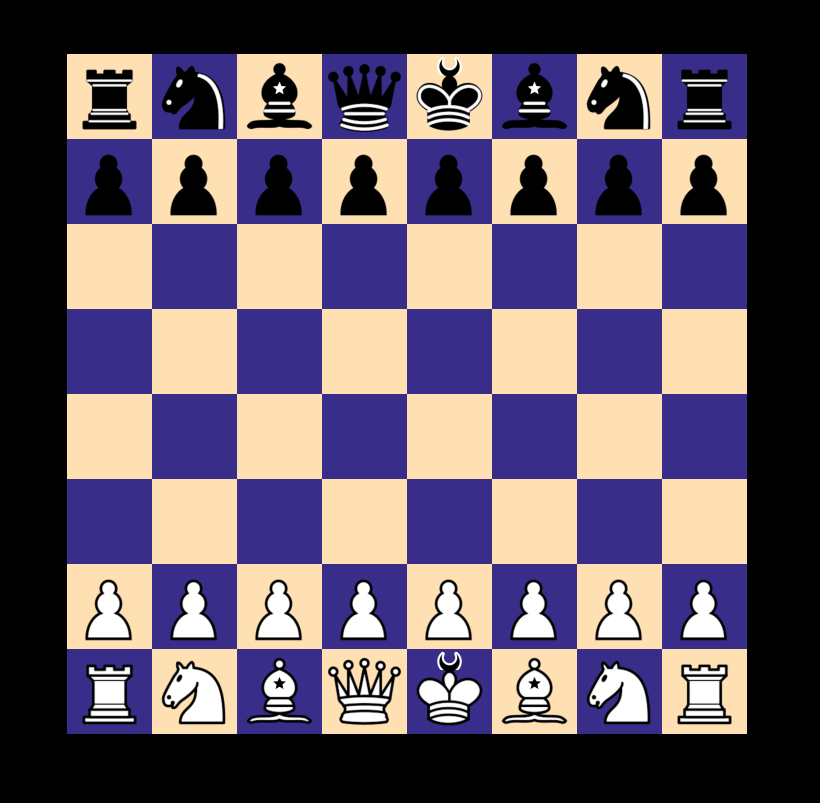

# Java Chess

A two-player chess game written in Java with a Swing GUI. Pieces are moved by dragging them with the mouse, and every legal move is highlighted.

<!-- Add a screenshot here:  -->

## Features

- Full set of piece movements (king, queen, rook, bishop, knight, pawn)
- Special moves: castling (short and long), en passant, and pawn promotion with a choice of piece
- Check detection: you cannot make a move that leaves your own king in check
- Game end detection: checkmate, stalemate and insufficient material
- Green highlights show all legal moves of the selected piece
- When the game ends, the final position stays on the screen together with the result message

## How to play

- White moves first, then the players take turns.
- Press and hold a piece, drag it to a green square and release it.
- An illegal move sends the piece back to where it was.
- When a pawn reaches the last rank, a dialog asks which piece it should become.

## Requirements

- JDK 25 or newer (the entry point uses an instance `main` method without a class declaration).
  JDK 21 to 24 also work if preview features are enabled.
- An IDE such as IntelliJ IDEA is recommended: open the project and run `src/Main/Main.java`.
- `src/res/Pieces.png` must be on the classpath. In IntelliJ, mark `src/res` as a *Resources Root*.

## Project structure

```
src
├── Main
│   ├── Main.java          Entry point: creates the window and the board
│   ├── Board.java         Board state, move rules, drawing, game end handling
│   ├── Input.java         Mouse handling (select, drag, drop)
│   ├── Move.java          One move (piece, start, target, captured piece)
│   └── CheckScanner.java  Check, checkmate and stalemate detection
├── pieces
│   ├── Piece.java         Base class: position, colour, sprite
│   ├── King.java  Queen.java  Rook.java
│   └── Bishop.java  Knight.java  Pawn.java
└── res
    └── Pieces.png         Sprite sheet with all piece images
```

## Not implemented yet

- Draw by threefold repetition and the fifty-move rule
- Restart / new game button
- Move history and undo
- Computer opponent

## License

This project is licensed under the MIT License. See the [LICENSE](LICENSE) file for details.


#### Build with ❤️ by Mohammed Elmaghraby.